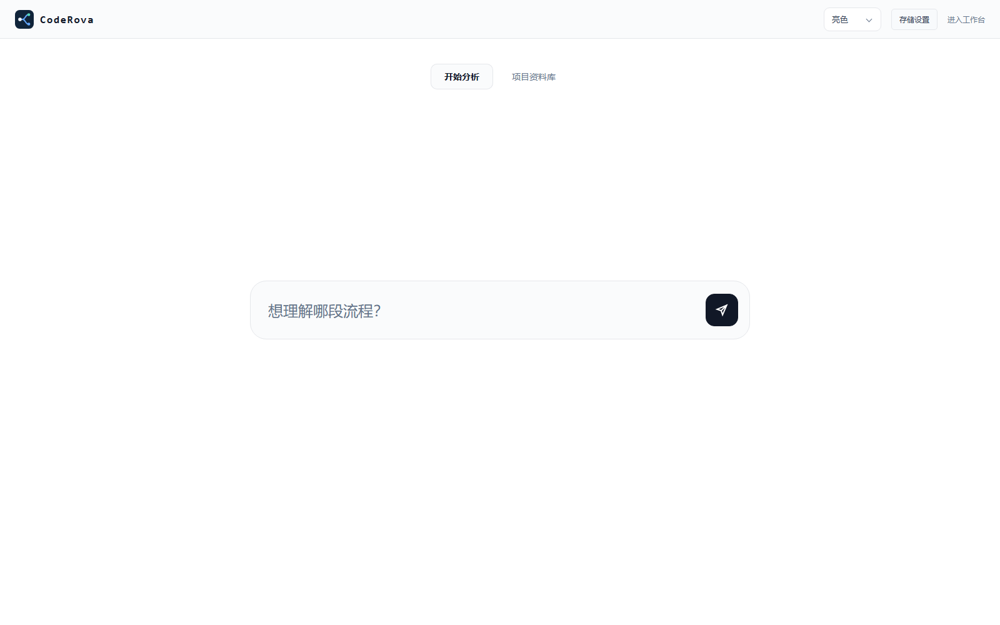
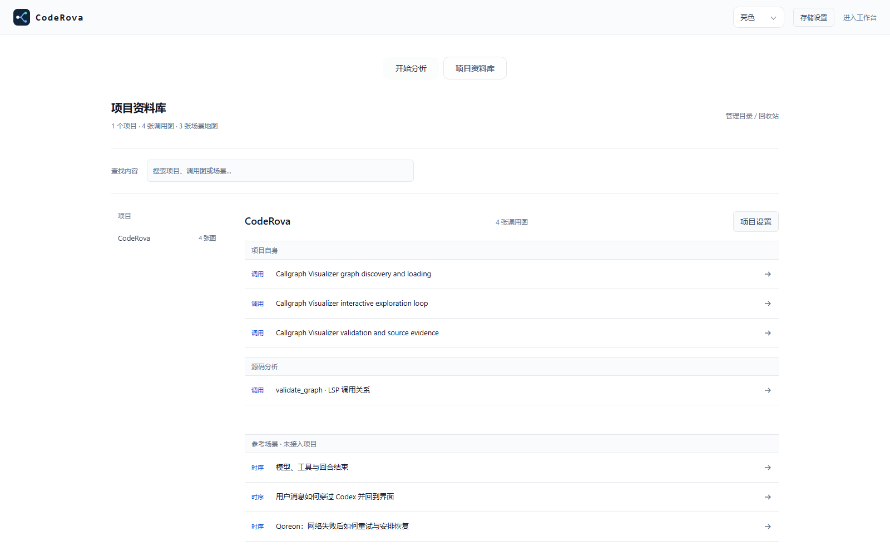
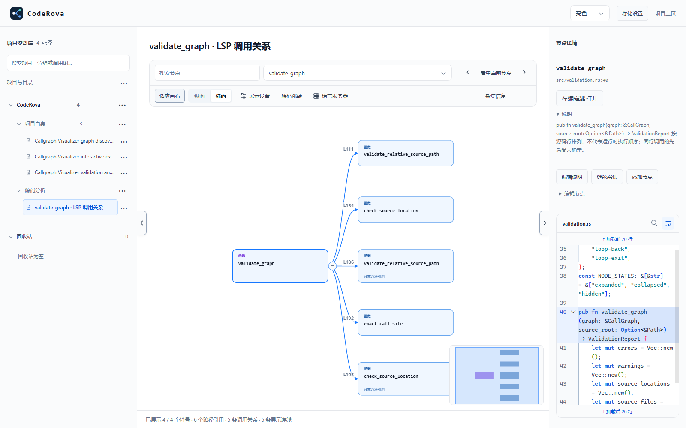

<p align="center">
  
</p>
<h1 align="center">CodeRova</h1>
<p align="center">从入口理解调用流程，在源码中验证每一步。</p>
<p align="center"><a href="#快速开始">快速开始</a> · <a href="#lsp-配置">LSP 配置</a> · <a href="docs/skills/callgraph-workbench/SKILL.md">使用手册</a> · <a href="LICENSE">MIT License</a></p>

本地运行的源码调用图工作台。使用 Rust / Java 语言服务器生成调用关系，再通过按需展开、源码预览、分支整理和异步入口补充，把陌生项目整理成可验证的执行路径。人和 AI 均可操作。

## 本次更新

- 打开图后从根节点开始阅读；详情栏展示节点采集状态、折叠的历史诊断及当前路径的调用依据入口。没有下游连线不会被标成业务流程结束。
- 采集状态读取失败会自动重试，不重复发起采集；预览、采纳和放弃结果局部更新画布，保留阅读位置、已有路径引用与无关分支的折叠状态。
- 统一侧栏末尾操作菜单，补齐新建项目、目录、图与重命名；修复下拉框展开换行和侧栏折叠响应。
- 新建图只做轻量源码位置校验；首次采集再通过 LSP 确认函数。Windows 文件/目录选择器统一，修复中文 URI 与路径别名匹配。
- 任意现存可采源码节点都可续采；深度与新增节点数可分别或同时限制，重复结果合并，统计区分新增与总量。
- LSP 和采集详情收进工具栏面板；源码预览补满视口、上下加载更多、节点间共享换行偏好，说明默认展开并支持右键编辑。
- 图事实与说明分离存储，目录元数据与图放在同一资料库；新增 `coderova.storage.json` 和页面存储设置。

操作与升级细节见[使用手册](docs/skills/callgraph-workbench/SKILL.md)和[配置与备份](docs/skills/callgraph-workbench/references/configuration.md)。

## 节点直达

节点详情操作栏支持“复制节点链接”。打开 `/?graph=<图标识>&node=<节点ID>` 后自动展开到节点并居中，刷新仍可直达。链接只包含图和符号标识，不包含本机源码路径；共享方法会定位到该符号的一条路径。

命令行可生成或打开同一链接（先启动服务，图文件须在该服务的资料库中）：

```sh
coderova link graphs/project/recursive-calls.json --node lsp-4dec4e1420330011 --base-url http://127.0.0.1:4317/ --launch
```

去掉 `--launch` 只输出链接；已有 `coderova open` 仍用于源码 URI。

源码运行时将 `coderova` 替换成 `cargo run --`。`--base-url` 默认端口为 4317，使用其他端口时传入实际地址；命令不会自动启动服务。草稿新增节点须保存后再分享，节点删除或 ID 变化后需重新复制链接。localhost 链接仅在当前电脑有效。更多边界见[节点直达操作手册](docs/skills/callgraph-workbench/references/workbench.md#节点直达与复制链接)。

## 递归调用示例

源码版启动后，在 CodeRova 默认项目的「项目自身」中打开「递归调用：直接递归与相互递归」，或访问 `/?graph=recursive-calls`。图包含 4 个方法、6 个调用点，展示两处自调用和两个方法之间的相互递归。节点说明解释递减参数与退出条件，点击连线可核验调用源码。

随附源码：[examples/recursion.rs](examples/recursion.rs)，运行 `cargo run --example recursion` 可验证示例正常结束。图由 rust-analyzer 实际采集，浏览示例无需启动语言服务器；继续采集需要配置 rust-analyzer。

## 页面预览

**创建入口** — 输入想理解的流程，从项目内源码建立调用图。



**项目资料库** — 按项目、分组浏览图卡片，查看节点与关系数量，搜索后直接进入源码工作台。



**调用图工作台** — 从入口逐层展开，结合调用位置、缩略图与源码定位理解分支。



截图更新于 2026-11-03，来自 v0.1.2 界面和 CodeRova 自身示例图的隔离演示资料库；未包含个人业务项目源码。项目列表和已采集内容取决于你的本机数据。

## 能做什么

| 功能 | 使用方式 |
| --- | --- |
| 从源码创建调用图 | 选择项目、文件和方法所在行，创建根节点，再配置采集范围 |
| LSP 采集与续采 | 支持 Rust rust-analyzer、Java Eclipse JDT LS；工具栏内启停服务器；可从任意现存源码节点继续采集、合并重复结果 |
| 阅读大图 | 按需展开、收起分支、横纵布局、缩略图、根节点到当前节点的路径高亮与调用位置标注；刷新默认不高亮 |
| 补充与整理 | 添加异步入口；保留多态方法与实现供选择；隐藏或删除节点及下游分支 |
| 验证源码 | Monaco 预览、搜索与行选择；上下各次加载 20 行，自动补满视口，所有节点共用换行设置；跳转 VS Code / IntelliJ IDEA |
| 审阅后保存 | 采集结果先预览，新增与删除在草稿中整理，确认后保存；离开未保存页面会提示 |
| 管理图谱 | 末尾“⋯”菜单新建项目/目录/图、重命名、移动与回收站；资料库位置可配置 |
| AI 操作 | 提供工作台 Skill、HTTP API 和操作脚本，可生成、续采、整理并保存图谱 |

> 调用图是静态分析结果，不是运行时轨迹。反射、框架回调、动态分派、宏等可能需要补充或人工确认；调用位置也不等于实际执行次数。

## 快速开始

### Windows 免安装版（推荐）

1. 打开 [GitHub Releases](https://github.com/v-liuxingan/CodeRova/releases/latest)，下载 `coderova-v版本号-windows-x64.zip`（不是 Source code）。
2. **完整解压**到可写目录，双击 `Start.cmd`。启动器自动选择空闲本机端口，服务就绪后打开浏览器。
3. 保持启动窗口打开；结束使用时按 `Ctrl+C` 停止服务。

无需安装 Rust、Node.js 或 Python。包内自带前端资源，初始项目列表为空，不包含作者的本机数据。
在页面“新建项目/接入项目”选择现有源码目录，即可新建图；也可编辑包内 `callgraph.projects.local.json` 后重启。新建项目是接入源码，不是生成工程脚手架。
采集功能仍需配置相应 LSP 和目标项目工具链；免安装的是工作台本身。

压缩包旁提供 SHA-256 校验文件。当前包面向 Windows x64，未进行代码签名。
如果 Windows 策略阻止 PowerShell 脚本，请遵循管理员策略；也可在解压目录的终端直接启动：

```powershell
.\coderova.exe serve --port 4324 --config callgraph.projects.local.json
```

然后手动访问 http://127.0.0.1:4324/ 。

**升级：** 解压新版到新目录，保留完整资料库（包括隐藏的 `.coderova/`、`.annotations-*` 及回收站文件）、`layouts/`、项目与 LSP 配置，以及可选的 `coderova.storage.json`。自定义资料库可继续指向原位置；相对路径需按新配置目录检查。不要用包内空配置覆盖已有数据。详见[配置与备份](docs/skills/callgraph-workbench/references/configuration.md)。

以下是源码构建方式。

### macOS 源码运行（Apple Silicon / Intel）

目前不提供 Mac 预编译包。安装 Xcode Command Line Tools（`xcode-select --install`）、Rust stable 和 Node.js 22+ 后，在终端执行：

```sh
git clone https://github.com/v-liuxingan/CodeRova.git
cd CodeRova
npm ci
npm run build:frontend
printf '%s\n' '{"schemaVersion":"0.1","projects":[]}' > callgraph.projects.local.json
cargo build --release --locked
./target/release/coderova serve --port 4324 --config callgraph.projects.local.json
```

上面的空配置初始化命令仅用于首次克隆，不要覆盖已有配置。打开 **http://127.0.0.1:4324/**，通过“新建项目/接入项目”选择自己的源码目录；也可按下文手工填写配置，路径例如 `/Users/me/projects/my-app`。

服务从仓库根目录运行，需保留 `public/`；终端关闭或按 `Ctrl+C` 后服务停止。编译完成后，日常启动不需要 Node.js。系统文件/目录选择使用 macOS 自带的对话框，需要本机图形登录会话；SSH 或无桌面环境使用配置文件和页面内文件列表。

只阅读图无需 LSP；采集 Rust 时按下文安装 rust-analyzer。采集 Java 时，将配置中的 `command` 改为本机 JDK 的 `bin/java`（可用 `/usr/libexec/java_home` 查询），JDT LS 的 `-configuration` 指向发行包中对应 Mac 架构的目录；JDK、JDT LS 与项目构建工具需匹配本机架构。不要沿用 Windows 的 `.exe`、盘符或 `config_win`。`workspaceRoot` 可设为 `/Users/me/Library/Caches/CodeRova/jdtls`，JSON 内使用实际绝对路径，不使用 `~` 或 `$HOME`。

仓库包含 Apple Silicon / Intel 的 macOS 源码验证工作流，执行构建、后端测试和浏览器集成检查，不上传可执行文件或创建 Release。原生对话框的交互及真实 Java/Rust 项目采集仍需 Mac 实机验收；跨目标 `cargo check` 不能替代运行验证。

### 1. 准备环境

- Git。
- [Rust / Cargo](https://www.rust-lang.org/tools/install)：当前 stable 工具链；项目使用 Rust 2024 edition。Windows 使用 MSVC 工具链时还需 Visual Studio C++ Build Tools。
- [Node.js](https://nodejs.org/en/download)：22 或更新版本，带 npm，用于构建前端。
- **只阅读已有图不需要 LSP**；采集 Rust / Java 时再安装下文对应的语言服务器和目标项目工具链。

### 2. 克隆并启动

在 PowerShell、Git Bash 或终端执行：

```sh
git clone https://github.com/v-liuxingan/CodeRova.git CodeRova
cd CodeRova
npm ci
npm run build:frontend
cargo run --locked -- serve --port 4324
```

打开 **http://127.0.0.1:4324/**。首次启动会编译 Rust，后续启动可复用构建结果。终端保持运行，按 `Ctrl+C` 停止。

仓库自带示例图。可先查看 **CodeRova** 项目；其他示例的源码目录需要按下一步映射到本机。所有前端资源在本地提供，无需 CDN；首次安装 npm / Cargo 依赖需要联网。

### 3. 配置自己的项目

在仓库根目录新建 `callgraph.projects.local.json`：

```json
{
  "schemaVersion": "0.1",
  "projects": [
    {
      "id": "callgraph-visualizer",
      "name": "CodeRova",
      "root": "."
    },
    {
      "id": "my-app",
      "name": "我的项目",
      "root": "E:/projects/my-app"
    }
  ]
}
```

将 `my-app` 的路径替换成**已存在的源码项目根目录**，不需要它时删除该项。Linux / macOS 可用 `/home/me/projects/my-app` 等路径。

- `id` 是图数据引用的项目标识，创建图后应保持稳定。
- `root` 支持绝对路径或相对于**配置文件所在目录**的路径；Java 通常指向 Maven / Gradle 根项目，Rust 指向 Cargo 工作区。
- Windows JSON 路径推荐 `/`；使用反斜杠时需写成 `\\`。
- 源码必须位于所选项目根目录内，支持任意层级子目录。此范围用于源码读取校验与 LSP 工作区定位。
- 此本机配置文件已被 Git 忽略，避免提交个人路径。它不会自动覆盖默认配置，启动时需显式传入：

```sh
cargo run --locked -- serve --port 4324 --config callgraph.projects.local.json
```

图默认写入启动工作目录的 `graphs/`。页面顶部“存储设置”或项目配置旁的 `coderova.storage.json` 可指定资料库位置，重启后生效，不会自动搬迁旧文件。非默认 `--graphs <目录>` 优先；当前实现将字面值 `--graphs graphs` 视为默认值，仍会读取存储配置。主题、侧栏等界面偏好与图文件分开保存。

```json
{"root":"D:/CodeRovaLibrary"}
```

`root` 也可为相对于项目配置文件所在目录的路径。目录别名、空分组、图与独立说明统一置于资料库；重命名只改变显示名，不改变源码位置或稳定 ID。详见[配置与备份](docs/skills/callgraph-workbench/references/configuration.md)。

### 4. 创建第一张图

1. 首页输入图名进入创建流程，或从工作台左侧“⋯”选择 **新建图**；没有项目时先 **新建项目/接入项目**。
2. 选择项目内文件，在编辑器中搜索目标函数，点击声明所在行。
3. 入口校验只核对文件、行号和非空源码，不等待 LSP；创建后根节点先表示待解析的源码位置。
4. 完成 [LSP 配置](#lsp-配置)。首次采集才确认真实函数；可在工具栏 **语言服务器** 面板查看类型、状态和启动/停止操作。
5. 设置 **采集深度** 与 **新增节点上限**，可同时填写，也可留空其中一项或两项。默认 3 层、100 个新增节点；达到任一限制即停止，查询预算保护仍有效。
6. 在工具栏 **采集信息** 查看本轮新增、图总量和失败边界。预览后 **采纳并保存** 才写入整份草稿。
7. 需要深入时，选中任意支持 LSP 采集的源码节点（包含已采节点），从右键或详情继续采集。重复符号和调用点合并，已有说明保留；新增为 0 不等于采集失败。

节点详情将状态、继续采集与编辑说明放在同一行；添加、隐藏、删除等操作集中在末尾 **⋯**，与画布右键菜单一致。菜单支持方向键导航与 Esc 关闭并返回入口。

顶部使用单个可搜索节点选择框，按方法名、类名或文件名查找全图节点（包括未展开节点），结果附带类与文件位置；大图最多同时展示 100 项，继续输入即可缩小范围。四向导航与居中按钮保留在旁边。

画布获得焦点且已选择节点或连线时，方向键按实际画布位置导航。相连节点之间先停在调用边，再到另一端节点；无连线的同层节点继续按空间方向切换。
该方向没有候选时停留，不循环跳转；隐藏和未展开节点不参与，多选时不跳转。顶部四向按钮与方向键共用逻辑；空格与居中按钮将当前节点或连线移到画布中央，保持缩放和多选。
“源码跳转”面板的“自动跳转”开启后，点击、方向键、导航按钮和节点搜索均同步打开所选源码；节点跳到定义，精确边跳到调用点。居中及后台刷新不触发，快速切换时旧跳转响应失效。

按住 Shift 拖动框选多个节点，再拖动任一选中节点即可一起移动；Esc 取消框选。
右键任一选中节点可“隐藏所选”或“删除所选”；入口自动保留，同一方法的调用位置去重处理。
删除前展示整个集合的节点/连线影响范围，确认后一次性进入草稿；共享下游仍有外部引用时保留。
框选不切换正在阅读的源码，搜索框、编辑器和其他控件中的方向键、空格仍执行各自操作。
操作提示在“展示设置”中；节点位置调整仅对当前会话生效。

大图采用视口增量挂载与缩放细节分级，平移时复用仍在视口内的元素，保留节点内容，不因拖动隐藏文字。概览隐藏不可读的边标签和箭头，放大恢复，不改变图数据；实测结果及剩余瓶颈见[大图性能专项](docs/large-graph-performance.md)。

采集深度控制本轮分析范围；展示深度只控制画布展开范围，两者不同。临时隐藏不写入图文件；删除属于草稿改动，需要保存后生效。已有图的编辑不会因为刷新页面自动保存。

### 编译后运行

```sh
cargo build --release --locked
```

从仓库根目录启动，确保相对资源路径正确：

```powershell
# Windows PowerShell
.\target\release\coderova.exe serve --port 4324 --config callgraph.projects.local.json
```

```sh
# Linux / macOS；Windows Git Bash 则使用 .exe 后缀
./target/release/coderova serve --port 4324 --config callgraph.projects.local.json
```

部署时需携带 `public/` 及所需配置、图数据；单独复制可执行文件不包含前端。已编译程序运行不需要 Node.js。默认监听 `127.0.0.1`，面向本机使用；不传 `--port` 时默认端口为 `4317`。

## LSP 配置

### Rust：rust-analyzer

```sh
rustup component add rust-analyzer rust-src
rust-analyzer --version
cargo metadata --format-version 1 --no-deps
```

最后一条在**待分析项目根目录**运行，用于检查 Cargo 工作区。启动平台的终端必须能找到 `rust-analyzer`，仅在编辑器中安装扩展不保证命令可用。项目若指定 `rust-toolchain.toml`，也需为对应工具链安装所需组件。参见 [rust-analyzer 安装说明](https://rust-analyzer.github.io/book/installation.html)。

Rust 无需另建 LSP JSON 配置。当前默认关闭构建脚本和过程宏执行，因此依赖这些能力的调用关系可能缺失。

### Java：Eclipse JDT LS

1. 下载并解压 [JDT LS milestone 发行包](https://download.eclipse.org/jdtls/milestones/)。
2. 安装该版本要求的运行 JDK。[当前官方说明](https://github.com/eclipse-jdtls/eclipse.jdt.ls#requirements)要求 **JDK 25 或更新版本**启动服务器；目标项目自身仍可能使用其他 JDK，需满足其 Maven / Gradle 构建要求。
3. 将 [配置模板](callgraph.lsp.example.json) 复制为根目录下的 `callgraph.lsp.local.json`，修改其中的本机路径：

```json
{
  "java": {
    "command": "E:/tools/jdk-25/bin/java.exe",
    "args": [
      "-Declipse.application=org.eclipse.jdt.ls.core.id1",
      "-Dosgi.bundles.defaultStartLevel=4",
      "-Declipse.product=org.eclipse.jdt.ls.core.product",
      "-Xmx2G",
      "--add-modules=ALL-SYSTEM",
      "--add-opens", "java.base/java.util=ALL-UNNAMED",
      "--add-opens", "java.base/java.lang=ALL-UNNAMED",
      "-jar", "E:/tools/jdtls/plugins/org.eclipse.equinox.launcher_REPLACE_WITH_ACTUAL_VERSION.jar",
      "-configuration", "E:/tools/jdtls/config_win",
      "-data", "{workspace}"
    ],
    "workspaceRoot": "E:/caches/callgraph-jdtls",
    "settings": {}
  }
}
```

**需要修改的部分：**

| 字段 | 填写要求 |
| --- | --- |
| `command` | 启动 JDT LS 的 Java 可执行文件绝对路径 |
| `-jar` 后的参数 | 解压包中实际存在的 `plugins/org.eclipse.equinox.launcher_*.jar` 文件名；不能保留占位符或使用 `*` |
| `-configuration` 后的参数 | 对应操作系统和架构的配置目录；Windows 示例为 `config_win`，其他平台以解压包为准 |
| `workspaceRoot` | 可写的索引缓存目录；平台为各项目创建独立子目录 |
| `{workspace}` | 原样保留，平台自动替换，不要填源码目录 |
| `settings` | 可选的 JDT LS 设置，如项目 JDK、Gradle / Maven 导入配置 |

配置通过标准输入输出启动独立 JDT LS，不会连接 IDEA 或 VS Code 内部的语言服务器。平台不负责安装 JDK、Gradle、Maven 或项目依赖。

也可通过环境变量指定配置文件，然后从同一终端启动平台：

```powershell
# PowerShell
$env:CALLGRAPH_LSP_CONFIG = 'E:/config/callgraph.lsp.local.json'
```

```sh
# Bash
export CALLGRAPH_LSP_CONFIG=/home/me/config/callgraph.lsp.local.json
```

Java 首次导入大型项目需要建立索引和解析依赖，可能明显慢于后续查询。建议先确认目标项目能通过自身的 Maven / Gradle 导入；不要在依赖尚未下载时开启离线模式。平台可复用安全条件满足的短期 LSP 会话，但源码、配置变化或任务异常时会重新创建。

### 并发、超时与重试

在本地 `callgraph.lsp.local.json` 顶层添加 `collection`（与 `java` 同级），Rust 和 Java 共用：

```json
{
  "collection": {
    "concurrency": 4,
    "requestTimeoutSeconds": 15,
    "maxRetries": 3
  }
}
```

已有 Java 配置保留 `java` 部分，不要用上面片段覆盖整个文件。配置缺省时使用上面的默认值。
并发范围 1–32，查询超时范围 1–300 秒，重试范围 0–3。`maxRetries: 3` 表示首次之外最多重试 3 次，总计最多 4 次；预算按方法计数，不把重试当作新增方法。
超时会结束本次等待、发送 LSP 取消通知，迟到响应不再写入图。服务器不支持取消时可能仍在计算，不能保证物理计算立即停止。
超时及可重试的服务器内部错误使用新的请求 ID 重试；参数/协议错误与断开连接不盲目重试。
达到重试上限的节点保留为未完成并记录原因，其他分支继续，已成功的关系可采纳保存。
主进程仍同时只接受一个采集任务；并发指的是该任务内部的节点查询，不是多个图抢占同一会话。
新任务读取配置，配置变化使原热会话失效；初始化和项目索引等待不使用单次查询的 15 秒上限。

### 分析范围与多态

- 以配置的项目根目录为分析范围，不递归展开第三方依赖内部调用。
- 预算或深度耗尽会保留待采集边界，可继续采集；不要把“本轮完成”理解为“全项目已分析完”。
- 多态方法与实现使用虚线连接。只有一个可确认实现时继续采集；多个实现保留到实现方法一层，由人或 AI 选择需要深入的分支。
- 排除项使用项目相对文件或目录路径，不是任意 glob 表达式。

## 源码跳转

内置源码预览无需外部编辑器。需要在 IDE 中继续阅读时，在工作台选择 **VS Code** 或 **IntelliJ IDEA**。

- VS Code：本机需安装并注册 `vscode://` 协议。
- IntelliJ IDEA：本机需正确关联 `idea://` 协议。按 [IDEA 配置指南](docs/skills/callgraph-workbench/references/idea-setup.md) 配置并验证；仅安装 IDEA 不代表浏览器已能打开该协议。

## 常见问题

| 现象 | 检查方法 |
| --- | --- |
| 首页有示例，但源码打不开 | 示例引用其他项目；检查项目 `id` 和 `root`，并确认启动命令传了 `--config` |
| 提示项目中没有源文件 | 检查所选项目、根目录与文件相对路径；子目录受支持，但根目录外的文件不能读取 |
| Java 入口校验失败或采集很慢 | 检查 Java / launcher JAR / 配置目录是否存在、JDK 版本是否匹配，以及项目依赖是否可解析 |
| 新增节点为 0 | 可能结果与已有图重叠、无下游调用、达到预算、被排除或 LSP 尚无法解析；结合任务详情和源码判断 |
| 找不到 rust-analyzer | 在启动平台的同一个终端执行 `rust-analyzer --version`，检查 PATH 和 rustup 工具链 |
| 修改后刷新丢失 | 预览和草稿不会自动写入图文件，保留改动需点击保存 |
| 端口被占用 | 停止原终端中的服务，或换用 `--port 4325` |
| 复制程序后页面打不开 | 同时携带 `public/`，从正确工作目录运行，或显式指定 `--public` |

## 使用手册与 AI 接入

[工作台 Skill](docs/skills/callgraph-workbench/SKILL.md) 是完整操作入口，可供支持 Skill 的 AI 工具阅读：

- [页面操作](docs/skills/callgraph-workbench/references/workbench.md)：目录、分支、隐藏、删除、侧栏与保存。
- [配置与备份](docs/skills/callgraph-workbench/references/configuration.md)：存储位置、说明分离、配置优先级与升级迁移。
- [分析与自动化](docs/skills/callgraph-workbench/references/analysis.md)：初始图、断点采集、异步节点与验收。
- [AI 操作协议](docs/ai-operations.md)：HTTP API 与草稿操作。
- [图内容生成](docs/graph-authoring.md)：调用图内容与源码依据的编写入口。
- [证据检查](docs/content-verification.md)：验证源码位置、内容和过期证据。

## 开发与验证

```sh
npm ci
npm run build:frontend
cargo fmt --check
cargo test
cargo clippy --all-targets --all-features -- -D warnings
python -m pip install playwright
python -m playwright install chromium
python tests/run_e2e.py
```

Python 用于测试和可选操作脚本，日常运行服务无需 Python。浏览器测试使用隔离的临时项目和图目录。真实 Java LSP 测试另见 `tests/java_lsp_test.py`、`tests/java_polymorphism_test.py`，需要本机 JDT LS 配置。

| 目录 | 内容 |
| --- | --- |
| `src/` | Rust HTTP 服务、存储、源码校验、LSP 采集 |
| `frontend/workbench/` | G6 渲染、布局与交互 |
| `public/` | 页面、主题、Logo 和构建后的本地资源 |
| `graphs/` | 调用图 JSON |
| `scenes/` | 保留的生成工具输入目录，默认不包含场景示例；产品入口仅展示调用图 |
| `schema/` | 数据格式约束 |
| `docs/` | 系统设计、操作手册与开发约定 |

不要手改生成的前端资源，或自动刷新源码指纹来消除过期证据警告。当前节点拖动位置不持久保存；历史设计文档可能描述已退役界面，当前操作以 Skill 为准。

[产品战略](docs/product-strategy.md) · [开发边界](docs/agent-development-boundaries.md) · [系统设计](docs/system-design.md) · [开发进度](docs/development-status.md)

## 发布 Windows 包

GitHub Actions 工作流 [`release-windows.yml`](.github/workflows/release-windows.yml) 在推送 `v*` 标签时执行前后端检查、编译、打包和解压启动测试，通过后上传 ZIP 与 SHA-256 到 GitHub Releases。使用静态 CRT 链接减少额外运行库依赖。

```sh
git tag v0.1.0
git push origin v0.1.0
```

后续发布使用新的版本号。Actions 手动运行只生成可下载的构建产物，不发布 Release。
本地构建后也可执行 `./scripts/package_windows.ps1 -Version v0.1.0`，输出位于 `target/packages/`。打包使用白名单，不收录本机图谱、配置、索引缓存或运行日志。

## 开源许可证

本项目采用 [MIT License](LICENSE)。第三方组件保留各自的许可证和版权声明，见 [THIRD_PARTY_NOTICES.md](THIRD_PARTY_NOTICES.md)。


### CodeRova 分析

平台统一使用 LSP，按源码语言选择语言服务器，不再提供 AST 分流。取舍与实测边界见 [分析器决策](docs/analyzer-decision.md)。

## 名称与兼容

产品统一命名为 **CodeRova**。Windows 发布包使用 `coderova-<版本>-windows-x64.zip`，包内程序为 `coderova.exe`。
GitHub 仓库已迁移至 `v-liuxingan/CodeRova`；源码构建的 Cargo 包和二进制统一为 `coderova`（Windows 为 `coderova.exe`）。旧构建产物不会自动改名，请重新构建并使用新程序。
`callgraph.*.json` 配置、`CALLGRAPH_*` 环境变量、项目 ID 和浏览器偏好键保持兼容，无需迁移已有数据。


### 从页面接入项目与准备 LSP

首页“新建图”→“接入项目”打开Windows本机目录选择器，选择源码目录并确认项目名称。
项目写入启动时所用的项目配置文件，重启后仍可选择；不需要手工填写项目ID。
现有项目在首页“项目设置”、新建图窗口或工作台工具栏“语言服务器”面板中可启动/停止语言服务器；单语言自动识别，
混合Rust/Java项目可切换语言。新接入项目没有图也会显示在首页。

主动启动会在后台准备服务器；可继续选文件。新建图入口校验不等待 LSP；已有图添加人工入口仍需要 LSP 确认。
关闭窗口不会停止主动启动的服务器。手动会话不按5分钟空闲回收，自动会话保持原策略；
源码/配置变化、进程异常和缓存资源限制仍可能导致重新启动。当前会话容量为2，
固定会话占满时请先停止一个；使用中需先停止采集或等待校验结束，再停止服务器。
“已启动”不保证整个项目的语义索引全部完成，首次查询仍可能需要等待。
Java仍需在本地LSP配置中安装并配置JDT LS/JDK，Rust需要rust-analyzer可启动。
主动启停不改变采集预算、15秒单次超时、失败边界和显式保存流程。

AI接口：`POST /api/projects/select-directory`返回短期selectionId（本机用户选择目录），
`POST /api/projects`提交`{"selectionId":"选择凭据","name":"项目名称"}`。
仅接受选择凭据，不接受浏览器提交的绝对路径。目录选择器目前支持Windows。
`GET /api/projects/{project}/lsp/{rust|java}`读取state/message/serverType；
`POST`同路径提交`{"action":"start"}`或`{"action":"stop"}`。
启动异步返回starting，轮询直到running/failed；重复启动复用，不另起进程。

### 向上查找调用者

新建图选择根节点并校验源码位置后，可选择“向下采集 · 它调用谁”或“向上采集 · 谁调用它”。
创建后继续配置采集深度和新增节点上限；入口校验不会提前启动 LSP。
向上图以所选方法为追溯起点，调用者向上展开（横向布局向左），箭头始终表示调用者 → 被调用者。
节点说明和源码预览保持一致，点击连线查看调用者中的调用点。
方向随图保存，续采继承该方向；历史图默认向下。重复采集增量合并，不覆盖说明。
“未发现调用者”只表示当前项目索引的查询结果，不证明该方法是程序入口；反射、代理等动态关系可能缺失。
本轮向上图不提供人工添加后续节点，避免把人工关系误当成反向调用证据。

CLI 同样支持 `analyze --direction incoming`；省略方向仍为 `outgoing`。
