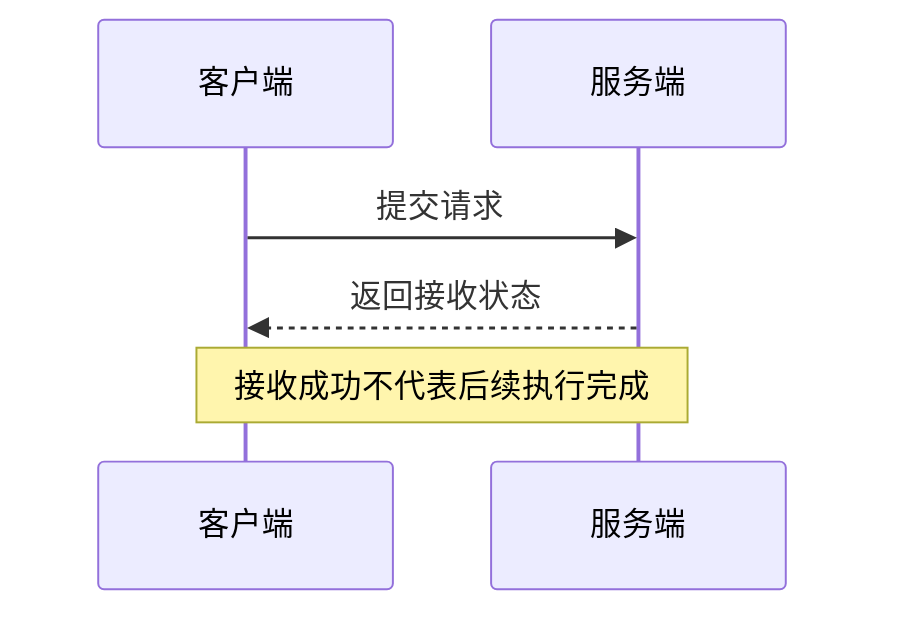
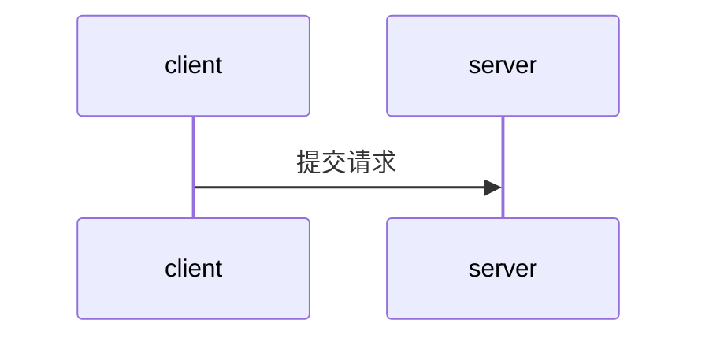

# 场景地图：Mermaid 时序文本 + 场景元数据

模型只需阅读本文、目标源码和一组 `scenes/*.mmd` / 同名 `.json` 示例，即可生成新的场景。
不必读取完整 diagram-design skill、渲染器源码或生成 HTML/SVG。skill 的时序表达与纸墨
配色已固化在项目中；模型专注执行事实和证据。

## 交付与构建

1. 在 `scenes/<slug>.mmd` 编写 Mermaid 时序图，在同名 `.json` 保存元数据。文件名用
   小写字母、数字、连字符或下划线，不使用 `index`。现有示例为 `codex-agent-turn`
   和 `qoreon-network-recovery`；两个文件应一起维护。
2. 运行 `npm run build:scenes`。共用渲染器生成 `public/scenes/<slug>.html`、场景目录和 `catalog.json`，
   无需手工登记目录，也不要修改生成后的 HTML。
3. 运行 `npm run check:scenes` 检查数据与产物是否同步；提交 `.mmd`、元数据 JSON 与生成页面。
   `npm run build:frontend` 也包含场景构建。仅改场景数据时不需要重建 Monaco。
4. 运行 `npm run check:content -- --project <项目ID>` 检查源码及基线。project.id 对应本地
   项目目录；location.anchor 可提供所引范围内的字面片段。详见 [证据检查](content-verification.md)。

调用图与场景数据分别生成和维护，由工作台统一切换阅读视图。无需 `targetIds`、phase 映射、
跨页选择状态或 `/api/scenarios`。旧 `scenarios/*.json` 属于 Atlas 实验协议，不是这里的输入。

主页是全量项目目录：所有项目同时展示，卡片内列出场景地图和调用图。点击场景会通过
`/?scene=<slug>` 在当前工作台直接展示时序图；点击关联调用图继续在同一工作台核对源码。
`/scenes/<slug>.html` 保留独立阅读兼容，但不作为主目录的中转步骤。
元数据的 `project.id` 应对应 `callgraph.projects.json` 中已登记的项目 ID，以便与调用图
归入同一项目；缺少 ID 的旧场景仍可从首页和场景目录的未关联项目分组阅读。
`callgraph` 仅提供可选的对应调用图标识，供统一阅读入口使用，不是节点映射。模型无需编写或手工登记 `catalog.json`，
也无需创建首页或场景前端页面。

## 数据结构

模型推荐入口是 Mermaid；JSON 只补充标题、范围和源码依据，避免重复描述时序。
项目在构建期将二者转换为内部语义数据，再校验、排版，不在浏览器运行 Mermaid 引擎。
元数据契约为 [`mermaid-scene.schema.json`](../schema/mermaid-scene.schema.json)。

下面两段分别保存为 `scenes/request.mmd` 和 `scenes/request.json`，即可构建。源码位置为
示例，实际生成时必须替换成核实过的目标源码事实。



```json
{
  "schemaVersion": "1.0",
  "title": "请求如何被接收",
  "summary": "客户端提交请求，服务确认收到后返回接收状态。",
  "project": { "label": "示例项目", "revision": "明确的提交或工作区版本说明" },
  "scope": {
    "startEnd": "提交请求 → 收到接收状态",
    "boundary": "只展开接收路径；后续异步执行不在本图范围内。"
  },
  "evidence": [
    { "id": "accept", "claim": "返回只确认接收，不代表后续执行完成", "locations": [
      { "file": "src/server.rs", "line": 42, "symbol": "accept_request" }
    ] }
  ]
}
```

| 字段 | 含义 |
| --- | --- |
| `title / summary` | 用户要理解的任务及流程概要 |
| `project` | 项目名称与本次核对的版本；没有固定提交时明确说明工作区状态 |
| `scope.startEnd / boundary` | 触发、终点，以及未展开范围；可选 `notes` 解释抽象边界 |
| 可选 `participantRoles` | `[{ "id": "server", "role": "请求处理" }]`；只补充职责，ID 必须出现在 Mermaid 中 |
| `evidence` | 结论及对应文件、符号、行号；通过 claim 明确对应的消息或控制流，页面保留源码依据表 |
| 可选 `theme` | `editorial`（默认纸墨）、`halo`（雾白蓝）、`aether`（深空蓝）、`signal`（荧光绿） |
| 可选 `callgraph` | 关联调用图的 slug，仅生成基础跳转；不携带路径或节点 ID |
| 可选 `caption / reading` | 图注及读图要点；`reading` 项含 `title / text` |

源码 `file` 使用项目内相对路径；`line / endLine` 提供精确位置。仅能定位文件时可省略
行号，页面会明确显示“文件级依据”，不能伪造行号。所有说明都是纯文本，不支持 HTML。

## 支持的 Mermaid 语法

这是明确受限的 `sequenceDiagram` 输入契约，不宣称兼容完整 Mermaid。

| 语法 | 含义 |
| --- | --- |
| `participant id as 显示名称` | 声明参与者；建议在图首声明，按首次出现顺序排列泳道 |
| `A->>B: 请求` | 调用或请求；不据此推断业务完成 |
| `B-->>A: 结果` | 返回或结果 |
| `A-)B: 事件` | 异步派发；等待、汇合关系仍须明确表达 |
| `A->>A: 操作` | 自调用 |
| `Note over A: 说明` / `Note over A,B: 说明` | 对一个参与者或两者之间的区域说明 |
| `alt 条件` / `else 条件` / `end` | 互斥分支；可写多个 else |
| `par 区域说明` / `and 区域说明` / `end` | 并发区域；上下位置不代表先后或自动汇合 |
| `opt 条件` / `end` | 可选行为 |
| `loop 条件` / `end` | 循环 |
| `%% 注释` | 独立一行的注释 |

控制流可嵌套，区域必须非空；ALT/PAR 至少两个分区，单路可选行为用 OPT。
ID 使用英文字母、数字、下划线；消息可隐式引入参与者，Note 只能引用已出现的 ID。
每行一条语句；文本换行用 `<br/>`，文字中的分号用 `#59;`，井号可用 `#35;`。
支持十进制字符实体，以及 `#quot;`、`#amp;`、`#lt;`、`#gt;`；其他 HTML 按纯文本显示。

暂不支持 actor、激活条、创建/销毁、ref、break、critical、box、rect、autonumber、
Note left/right、其他箭头（包括 `--)`）、前置配置或样式指令。这些语法会附文件名、
行号报错，不能静默删去或压平。需要这些执行语义时，应先扩展内部契约和渲染器；
不要为了让构建通过而删掉关键行为。

同名 `.mmd` 存在时，元数据不能再写 `participants` / `body`，也不能指定其他输入路径。
没有 `.mmd` 时，仍接受下述完整 JSON 入口；孤立 `.mmd` 会报缺少元数据。

## 兼容入口：完整语义 JSON

已有生成器可以继续输出 `scenes/<slug>.json`（不配同名 `.mmd`），正式契约为
[`sequence-scene.schema.json`](../schema/sequence-scene.schema.json)。在上述公共元数据中
增加 `participants` 和 `body`，移除仅 Mermaid 元数据支持的 `participantRoles`。
参与者为 `{ id, label, role? }`，以下是 body 的步骤类型。需要消息或说明直接引用源码
依据 ID 时，两种入口均可使用；Mermaid 使用下述可选注释，不重复输出 body。



`%% @evidence accept,other` 将下一条消息或 Note 关联元数据中的依据 ID。插入其他消息
不会改变关联，不需要维护序号。注释不能悬空、跨过控制框或引用不存在的 ID。
点击消息或说明可跳到本页依据表；多依据时先到第一项，编号列出全部依据。
仅给关键交接补充注释，不设置标注比例要求。控制条件可通过旁边的 Note 标注。
evidence.status 可选 source/inferred；未标注不会被显示成已验证。

- **消息**：`{ type: "message", from, to, kind, label }`。`kind` 为 `call`（调用/请求）、
  `return`（返回/结果）或 `async`（异步派发/事件）；`from == to` 表示自调用。
  异步不自动意味着无需等待，必要时在后续消息或条件中明确等待关系。
- **说明**：`{ type: "note", text }`，可选 `over: [参与者ID]` 说明作用对象，默认横跨参与者。
  说明不代替关键调用和交接。消息与说明可选 `evidence: [依据ID]`。
- **可选/循环**：`{ type: "opt" 或 "loop", condition, body: [...] }`。
- **分支/并发**：`{ type: "alt" 或 "par", branches: [{ condition, body: [...] }, ...] }`。
  ALT 至少有两个候选分支；只有一路可选行为时用 OPT。PAR 至少有两个并发区域，区域的
  上下位置不表示它们启动或完成的先后，也不自动声明所有区域在框尾完成汇合。

`body` 可以继续嵌套这些类型。条件直接写触发事实，不需要生成括号、线型或几何参数。
不要把条件、互斥与并发压平成固定步骤列表；也不要因为可画出来就虚构执行关系。

## 完整性原则

先确定场景边界，再核对源码和关键转折。区分请求被接收、模型响应结束、工具完成和整个
回合结束。只有证据支持的依赖才能表达为严格先后；未确认关系和范围外路径需明确说明。

参与者、消息、分支与嵌套不设固定数量上限。渲染器自动换行并扩展画布；参与者较多时
横向滚动，长流程纵向阅读。拆场景必须按实际职责或生命周期边界，并说明未展开部分，
不能为了数量目标删除范围内的重要分支、回环或终点。

渲染器在时序图顶部和底部重复显示参与者名称与职责，并用生命线连接。
模型只需声明一次参与者，长流程底部的角色信息由项目自动生成。

配色由项目根据 Mermaid / JSON 的语义自动完成：角色卡片按泳道顺序使用循环色板，
调用、返回、异步派发各有颜色，ALT / LOOP / PAR / OPT 使用不同边框和浅底色。
颜色不表示风险、优先级或额外执行关系；角色名称、消息线型、控制流标签始终保留。
可在同名元数据 JSON 中写 `"theme": "aether"`（完整 JSON 入口也支持）并重新构建。
主题在构建时固定，不跟随调用图的浏览器偏好；省略主题仍会自动语义配色。打印时自动
切为浅底深字，避免关闭背景打印后深色主题文字不可读。模型不需要
提供颜色值，Mermaid 的样式指令仍不支持，避免主题冲突与逐图维护。

模型不输出 `x/y`、宽高、颜色、字体、箭头路径、SVG、CSS 或布局提示。加入不支持的字段
会报错，不会被静默忽略。需要新的执行语义时先扩展数据契约和共用渲染器。

## 验收与维护

- 核对每个重要结论的源码事实；构建校验只检查结构、引用与安全文本，不证明业务语义。
- `npm run check:scenes` 验证可重复生成。构建会先校验全部输入；Mermaid 语法错误、无效 JSON、重复 ID、
  不存在的参与者/依据和错误字段都附带文件或字段位置，不替换已有可读页面。
- 改动渲染器或集成时运行 `npm ci`、`npm run build:frontend`、`python tests/run_e2e.py`。
  测试覆盖多参与者、长消息、嵌套、转义、旧产物清理，以及禁用脚本后的桌面/窄屏阅读。
- 生成页面继续采用严格 CSP 和本地样式，无脚本或 API 依赖。布局错误在共用渲染器中修复，
  不让模型逐图修补坐标。构建器仅清理由它生成、且已没有对应场景的旧页面。
  若同名页面或目录页已存在且没有生成标记，构建会在写入前失败，保留全部已有页面；
  应先重命名或迁移手写文件，再运行构建。

用十分钟理解任务检验：读者能否复述起止边界、关键条件和状态变化，并通过基础跳转核对
源码。生成更省事和页面测试通过，都不能代替这个理解效果评估。
