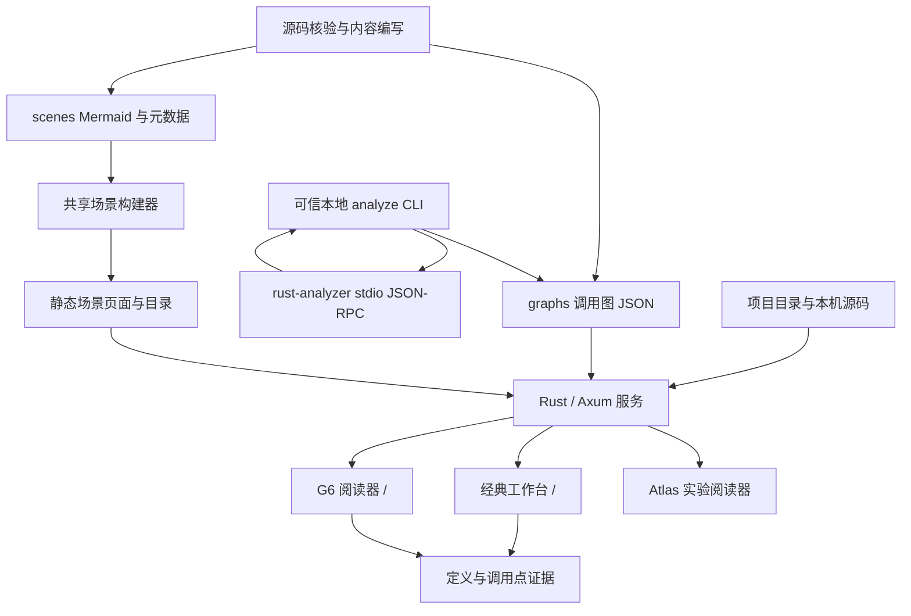

> 当前入口与实现已统一：`/` 为项目主页，`/?graph=<slug>` 为唯一 G6 工作台；源码位于 `frontend/workbench`。经典界面与 Atlas 实验入口已退役。下文旧版本章节保留设计历史，操作以 [工作台 Skill](skills/callgraph-workbench/SKILL.md) 为准。

# 当前系统设计

更新日期：2026-10-31。本文描述当前工作区已经实现的系统，规划和验收状态见
[开发进度](development-status.md)。接口细节以[开发边界与契约](agent-development-boundaries.md)
和实际代码为准。

## 1. 产品目标与设计约束

系统帮助开发者在 **10 分钟内建立陌生项目的可验证执行心智模型**。调用图负责定位
符号、关系与证据，场景图负责表达跨参与者的执行叙事。二者共用项目目录和基础跳转，
不要求模型生成前端页面、坐标或复杂的双向交互配置。

- 真实 `nodes / edges` 是调用图结构的唯一来源；不能为降低密度删掉有证据的分支、循环、异步或失败路径。
- 静态调用关系表示可能的调用，不等同于运行轨迹，也不自动证明业务含义。
- 重要结论可回到源码；分析失败、范围边界与未知机制需要显式保留。
- 默认保留完整上下文，选择后强调相关链路；视觉简化优先减少卡片信息，而非删减证据。

产品验收方法见[产品战略](product-strategy.md)。

## 2. 部署与模块结构

当前是一个 Rust 服务托管 API 和静态资源的单体应用，前后端实现独立演进，尚未拆成
多服务。V2 是同一应用中的新阅读器，不是另一个后端或独立产品。

| 层次 | 主要实现 | 当前职责 |
| --- | --- | --- |
| CLI 与分析 | `src/main.rs`、`src/analysis/` | 参数、LSP 会话、出向调用遍历、边界记录、JSON 导出 |
| HTTP 与应用装配 | `src/server.rs` | API 路由、状态装配、回环地址限制、响应安全策略、静态托管 |
| 领域与存储 | `src/model.rs`、`src/graph_store.rs`、`src/layout_store.rs`、`src/scenario_store.rs` | 图契约、目录发现、分类、归档恢复、布局与旧场景存储 |
| 源码证据 | `src/project_catalog.rs`、`src/source_preview.rs`、`src/navigation.rs`、`src/validation.rs` | 项目根解析、路径校验、源码范围、编辑器链接、内容校验 |
| 浏览器 API 边界 | `public/js/api.js` | 集中封装 HTTP 请求，避免各视图自行拼接文件路径 |
| V2 交互 | `frontend/workbench/entry.js` | G6 图装配、布局、选择、主题、导航与源码联动 |
| V2 组件 | `frontend/workbench/execution-node.js`、`frontend/workbench/library-tree.js` | Canvas 节点卡片、项目文件树及回收站 |
| 经典阅读器 | `public/js/`、`public/js/renderers/` | SVG、场景阅读、源码工作台、布局存储与调用步进 |
| 构建 | `scripts/build_frontend.mjs`、`scripts/build_scenes.mjs` | 本地前端依赖打包、共享场景页面生成 |

后端使用 Axum/Tokio；V2 使用 G6 5.1.1 Canvas；当前按最短调用距离进行横/纵分层，默认展示 50 层并可继续展开，详见[渐进展示](v2-progressive-rendering.md)。浏览器运行不依赖 CDN。
React/React Flow/ELK 属于 Atlas 实验实现，不是 V2 的渲染栈。

## 3. 三个前端入口的边界

| 能力 | 经典工作台 `/` | V2 `/` | Atlas |
| --- | --- | --- | --- |
| 定位 | 当前完整阅读能力的保留入口 | 新版调用图阅读与目录交互 | 保留兼容的实验实现 |
| 调用图渲染 | 自研 SVG | G6 Canvas，自定义节点 | React Flow / ELK |
| 场景阅读 | 已整合，共享生成页面 | 尚未迁移 | 保留旧场景接口消费者 |
| 源码阅读 | Monaco 工作台及 DOM 回退 | 安全 DOM 预览、关系详情 | 实验能力，不作为 V2 验收依据 |
| 手动布局保存 | 已有独立布局存储 | 暂不保存 | 不作为迁移承诺 |
| 构建 | `build:frontend` | `build:frontend` | 独立 `build:atlas` |

V2 尚未替代经典版的全部功能。经典版场景入口、源码步进等能力，不能因为仓库中存在
就宣称已经迁入 V2。历史收敛决策见[架构收敛记录](architecture-convergence.md)。

## 4. 数据与持久化

调用图 Schema 当前接受 0.2、0.3、0.4；0.4 增加可选分析报告。核心契约独立于 G6，
渲染器消费图数据，不向业务数据写入 G6 专用结构。

| 数据 | 内容与语义 | 存储位置 |
| --- | --- | --- |
| 项目目录 | 项目 ID、展示名、可信源码根 | `callgraph.projects.json` |
| 调用图 | 项目、入口、阶段、节点、边、源码位置与解释 | `graphs/**/*.json` |
| 分析报告 | 提供者、范围、预算、已查询及待查询节点、问题 | 图内可选 `analysis` |
| 场景源文件 | Mermaid 时序文本与 JSON 元数据，或完整场景 JSON | `scenes/` |
| 场景产物 | 共用样式与渲染逻辑生成的 HTML、目录 | `public/scenes/` |
| 用户布局 | 经典版图位置及方向相关状态 | `layouts/*.layout.json`，不默认提交 |
| 应用回收站 | 原图同目录改名保存，保留原文件内容 | `*.deleted`，非操作系统回收站 |
| 浏览器偏好 | V2 主题、树展开状态、同组排序、空分组 | 当前浏览器 localStorage |
| 证据基线 | 经人工审阅的源码指纹 | `evidence/` |

节点保存符号名、类型、文件范围和职责等；边保存来源、目标、关系机制、控制流语义、
调用点、解释与证据。`edge.order` 只表示已核实的调用者局部顺序；阶段顺序是布局提示。

当前没有独立的类名和方法名契约字段。V2 仅对方法类型的限定名称拆分展示所属类/所有者；
无法取得时省略，不猜测。分析图不会自动生成业务职责说明。

## 5. 三条主要流程

### 5.1 源码分析与导出

1. CLI 从已登记项目及相对文件位置确定入口，启动可信 rust-analyzer。
2. 通过 stdio JSON-RPC 初始化并等待索引，执行 `prepareCallHierarchy` 和出向调用查询。
3. 在深度和请求预算内遍历，处理环、多个调用点、错误及外部边界；LSP opaque data 原样回传。
4. 导出带 `analysis` 的调用图；拒绝覆盖已有文件。
5. 服务目录发现图，V2 加载并允许检查定义、调用点和分析范围。

预算限制计算工作，不表示剩余调用不存在。空结果、失败和未查询必须区分。
HTTP 尚不启动分析任务；当前适配依赖 rust-analyzer 的就绪机制，不承诺兼容任意 LSP。
构建脚本和过程宏执行关闭，可能影响分析覆盖。详细命令见[V2 开发说明](v2-development.md)。

### 5.2 浏览、选择与源码核验

项目树 → 选择调用图 → G6 布局 → 点击节点或边 → 强调相关链路 → 请求源码预览。
节点选择分别计算上游与下游，回环边保留但不继续扩散遍历。默认和切图后不选中；
空白单击取消，拖拽不取消。过期请求通过取消和路由版本检查避免覆盖当前视图。

卡片只展示类型、可取得的类/所有者、方法/符号名、可选简短职责；完整内容留在检查器。
亮色/深色使用统一语义样式，主题切换保留视口与选择。

拖拽使用 G6 行为。当前将拖拽插件启动阈值改为 0 ms、5 px，去除原 100 ms/10 px
启动等待，同时与空白点击判定一致。它修复启动不跟手，不代表已经完成所有规模下的性能优化。

### 5.3 分类、归档和删除

项目 → 分类 → 调用图构成目录树。展开层级缩进，支持同项目分类移动、局部排序和搜索。
分类移动通过 API 修改实际图存储；空分组、展开和排序是浏览器偏好，尚不跨设备同步。

单张图删除 → 移入应用回收站 → 恢复或二次确认永久删除。
恢复拒绝覆盖同名活动图；永久删除仅删除归档图文件，不删除源码或布局。只允许删除空分组，
不提供项目或非空分组批量删除。

## 6. API 与安全边界

- 图读取、分类、布局、校验使用 `/api/graphs` 相关路由；回收站使用 `/api/graph-trash`。
- 源码预览与编辑器链接使用 `/api/preview`、`/api/open`。浏览器提交图标识与目标 ID，服务端从已加载图和可信项目目录解析路径。
- 仅监听回环地址；源码读取校验根目录与目标范围，不允许浏览器指定任意文件路径。
- 通过 CSP 等响应头限制资源；经典版 Monaco 位于独立同源受限预览页面。
- 文件系统存储没有引入数据库、账户系统或远程多人协作服务。

请求/响应以 camelCase 命名，具体接口和跨边界修改步骤见
[开发边界与契约](agent-development-boundaries.md)，不在本文维护第二份完整接口规范。

## 7. 已知架构缺口与演进方向

1. V2 的阅读流程还未覆盖经典版场景、布局和完整源码工作台；应按连续阅读任务迁移，避免增加入口跳转。
2. 分析目前是 CLI 单次流程；浏览器任务、进度、取消和续查尚未实现。
3. 符号身份仅在相同源码快照中稳定；跨版本身份、缓存失效与增量分析尚未建立。
4. 第二语言适配、动态/框架关系推断与业务解释需独立证据和验收，不能由 LSP 调用层级直接推定。
5. G6 大图性能需要单独基准；经典 SVG 的性能结果不能用来证明 V2 性能。

实施优先级和验收条件见[开发进度](development-status.md)。内容生成入口见
[图内容生成](graph-authoring.md)，证据更新规则见[内容验证](content-verification.md)。
